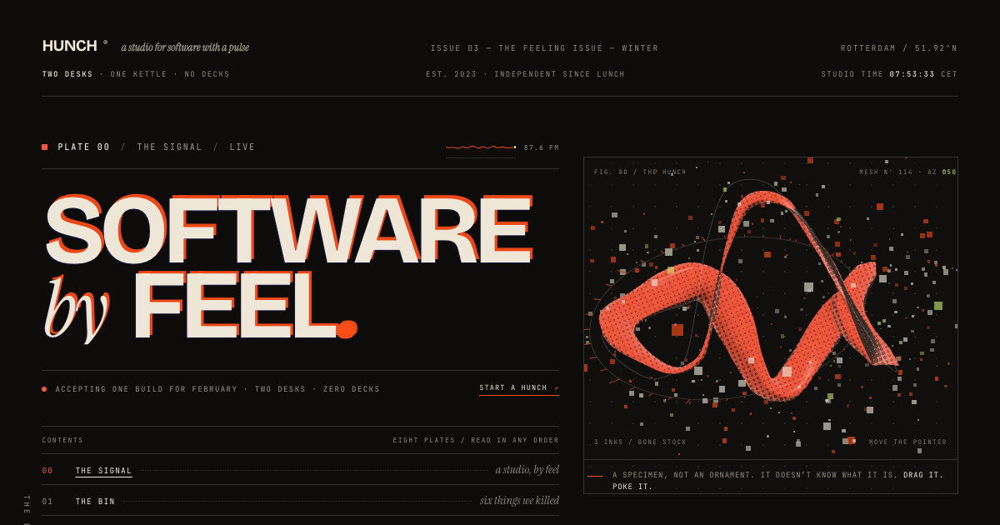

# HUNCH® — a studio for software with a pulse

A site for a fictional two-desk **vibe-code studio**. Built as a printed studio zine — *Issue 03, The Feeling Issue* — instead of a hero / features / pricing / footer template.

**[Live site →](https://hunch-studio-eight.vercel.app)** · **[GitHub](https://github.com/pixl4tech/hunch-studio)**

Built in one session with **DeepSeek V4.1 Flash 1017** (`maya-deepseek/deepseek-v4.1-flash`, Maya-S) at **reasoning: max**. The original brief is preserved in [PROMPT.md](PROMPT.md); the interaction-sound map is in [UI-SOUNDS.md](UI-SOUNDS.md).



## The idea

The whole page is one riso-printed issue. Eight numbered plates, a contents page, page-turn strips, crop marks, perforations, barcodes, a wax seal. No two plates share the same layout logic; each one is a different kind of printed page.

The art direction is a Risograph palette (ink, bone, orange, cobalt, lime), huge optical type, hairline technical labels — and a custom 3D "brushstroke specimen" printed with a screen-space halftone shader.

There are no scroll-reveal fades. Motion is either user-driven (dragging, patching, tuning, stamping) or a piece of print machinery (press-printing the headline, a platen flipping in the dock, a seal rotating).

## The plates

| Plate | What it is | What you can do |
| --- | --- | --- |
| **00 — The Signal** | The cover, a zine contents index, and a 3D specimen | Drag / poke the organism. Use the index or the bottom dock. Toggle the ink trail. |
| **01 — The Bin** | A draggable light table of six killed versions | Drag the filmstrip, flip a card, read the autopsy. |
| **02 — The Patch Bay** | Capabilities as a playable patch bay | Drag cables from a need to a system and get a generated spec. Presets and click-to-patch included. Take the patch to the Bench. |
| **03 — The Fugue** | The method as a draggable five-stave graphic score — and a real five-movement piece | Drag or arrow-key the needle; movements overlap and narrate. Tap a movement to hear its phrase. Press **Play the fugue** for the whole 25.6-second piece (it turns sound on). A quiet house-chord bed holds the overlaps in one harmony. |
| **04 — The Ledger** | Three ways in, printed as tear-off tickets | Stamp a ticket. The selection follows you to the Bench form. |
| **05 — The Séance** | Client testimony as radio transmissions | Turn the dial, scan channels, change the frequency. |
| **06 — The Bench** | The site as the demo | Tune warmth / grain / tempo and watch the accent, grain and 3D organism change live. Request a session — the console drafts a real mailto. |
| **07 — Sign-Off** | Masthead, rotating seal, colophon, barcode | Pointer-driven ink misregistration on the giant wordmark. Copy the address, go back to the cover. |

### HUNCH FM — the background loop

`src/lib/music.ts` is a second, independent engine: 32 bars at 92 BPM (about 83 seconds) in A minor, generated live. The harmony runs **Am7 – Fmaj7 – Cmaj7 – G6 | Am7 – Fmaj7 – Dm7 – E7**, with a lyrical lead, 16th-note arpeggios through a dotted-eighth delay, a dark eighth-note sequencer, warm pads and a restrained drum machine. The lead enters at bar 8 over the Dm–E7 half, so it is always voiced against the chord that is actually sounding.

The dock switch is the only control. It is off on a first visit, persists in `localStorage`, and starts on the next gesture (browsers do not allow autoplay). The Fugue has priority: starting a movement or the full piece fades HUNCH FM to silence over 0.7 s while a low-pass closes; the last tail releases it back over 1.4 s. Short needle entries duck it for 2.6 s.

### Plate 03 is an actual fugue

The stave and the sound are not two separate things. One score in `src/lib/fugueScore.ts` (notes, durations, dynamics, voice) feeds both the notation on screen and the WebAudio ensemble in `src/lib/fugueAudio.ts`.

One subject — **F–A–C–B♭–A–G** — enters five times:

| Movement | Transformation | Voice |
| --- | --- | --- |
| **I — Listen** | augmented ×1.6, two octaves up | felt piano, low F pedal, long air |
| **II — Loop** | the head of the subject as an eighth-note ostinato | muted plucks, ping-ponged, one dropped click |
| **III — Lash** | retrograde, diminished, one borrowed E♭ | saw bass, whip ticks, sub pedal |
| **IV — Lift** | spread into a rising arpeggio and harmonised | inharmonic bells, open F–C fifth, noise sweep |
| **V — Lull** | retrograde, slowed; the unresolved G finally falls to F | detuned pad, felt melody |

One week = one bar of 4/4 at ♩=75. Eight bars = 25.6 seconds, so the overlapping week ranges in the plate are literally overlapping voices. Registers are separated (Listen high, Loop mid, Lash low, Lift mid-high, Lull low-mid), a quiet house-chord bed changes with the week so the overlaps share one harmony, and every voice enters through a 0.6-second fade. The Lull pad withholds its 3rd until the final bar, so the melody's B♭ is a suspension rather than a cluster. The room is a short synthetic impulse response, normalised so the score — not the compressor — decides the balance.

## Stack

- **Vite + React 19 + TypeScript**
- **Three.js** with custom GLSL: a hand-built twisted ribbon geometry, vertex displacement, flat printed lighting, screen-space riso halftone, and square ink-fleck particles. No stock primitives, no post-processing stack.
- **Lenis** for the tuned scroll feel.
- **Hand-written CSS** (custom properties, fluid type, asymmetric grids) — no UI framework.
- **Fontsource** self-hosted fonts: Bricolage Grotesque, Instrument Serif, JetBrains Mono.

## Run it

```bash
npm install
npm run dev
```

Build:

```bash
npm run build
npm run preview
```

## Notes

- **No backend.** The session console doesn't send anything; it assembles the message and offers a mailto / copy-address route. The UI says so.
- **Fictional.** Clients, quotes and prices are invented; the studio is too.
- **Accessibility / care.** Semantic plates, keyboard support for patching, the score needle and the radio dial; focus states; `prefers-reduced-motion` freezes the 3D, the press intro, the marquee and the ink trail; WebGL has a printed fallback; the custom cursor is disabled on touch and on reduced motion; mobile layouts collapse intentionally rather than just shrinking.
- **Performance.** DPR clamped at 2, the organism pauses off-screen, the geometry is roughly 2.7k vertices, and there are no external image assets.
- **Fugue sound** is opt-in. A sample-free WebAudio ensemble plays a composed 25.6-second piece; every instrument is synthesised at runtime and the score is the single source of truth for audio and graphics.
- **Background music** is off by default. The **Audio** menu in the dock is available on every plate and remembers your choice. It is HUNCH FM: an original 32-bar synth loop at 92 BPM, generated live, no samples. Starting the Fugue fades it out through a closing filter; when the needle stops, it fades back in.
- **Interface sounds** are gated by the same master switch. Every physical gesture has its own material — paper taps, a ticket tear, a rubber stamp, a jack plug, a radio detent, fader friction, a wet ink squeegee. All synthesised at runtime, throttled and randomised so repeated clicks do not become a ringtone. The full inventory is in [UI-SOUNDS.md](UI-SOUNDS.md).

```
src/
  components/     the eight plates + chrome (boot, dock, cursor, ink)
  lib/            ticker, vibe context, scroll, plates, utilities
  styles/         base system + one stylesheet per plate
public/og.png     social card
```

## Colophon

Designed, written and built with **DeepSeek V4.1 Flash 1017**. Reasoning was **max** for the whole session; the original prompt is preserved verbatim in [PROMPT.md](PROMPT.md).

```
MODEL  maya-deepseek/deepseek-v4.1-flash
DeepSeek V4.1 Flash 1017 (Maya-S, pxl-lenovo-llm, 1M)

LIMITS
  context window   1,000,000  (1.0M)
  max output      131,072  (131k)
  reasoning        yes
  input            text, image

THINKING
  current level    max
  off      → off
  minimal  → — (unsupported)
  low      → low
  medium   → medium
  high     → high
  xhigh    → xhigh
  max      → max [.] (selected)

COST (per 1M tokens)
  input            $0
  output           $0
  cache read       $0
  cache write      $0

ENDPOINT
  provider       maya-deepseek
  api            openai-completions
  baseUrl        http://localnetwork:8081/v1

SAMPLING
  default        {"temperature":1,"top_p":1}
```
